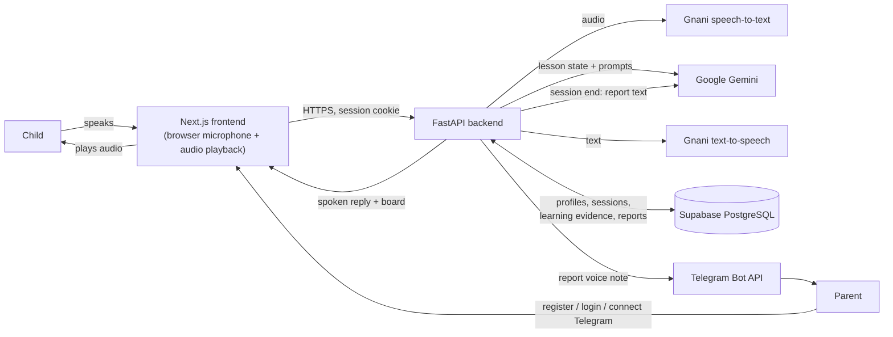

# Sakhi AI

**An AI-powered voice-first learning companion that makes education more engaging, accessible, and interactive for young learners.**


---

## Overview

Sakhi AI is a voice-first tutor for primary school children, currently delivering a complete learning experience for **Grade 3**. Instead of a text chatbot, the child talks to Sakhi, a friendly husky character, and Sakhi answers aloud, one small step at a time, the way a patient teacher would. Lessons are shown on a simple board (a word, a sentence, a letter, a sum) while Sakhi listens, corrects and encourages.

Young children often cannot type well or read long instructions, but they can speak. A spoken conversation lets them start learning immediately, practise reading aloud, and get feedback on exactly what they said. Parents stay informed: when a session ends, Sakhi prepares a short report of what the child practised and where they needed help, and sends it to the parent on Telegram as a voice note.

## Problem Statement

Many digital learning products are a poor fit for young learners:

- **Text-heavy interfaces** assume a reading and typing ability that early learners are still building.
- **Limited personalised interaction.** Fixed quizzes do not respond to what a child actually said or got wrong.
- **Engagement is hard to sustain** when feedback is generic or repetitive.
- **Parents have little visibility** into what happened in a session and which skills need more practice.

## Our Solution

Sakhi AI addresses these with:

- **Natural voice interaction**: the child speaks, Sakhi speaks back.
- **AI-phrased, guided teaching**: a deterministic lesson engine decides what to teach and how to correct; Gemini phrases Sakhi's words and judges ambiguous answers.
- **Multilingual teaching**: the syllabus stays in English while Sakhi teaches in English, Hinglish (Hindi in Roman letters) or Telglish (Telugu in Roman letters).
- **Session and mistake tracking**: each question, the child's answers, hints and outcome are recorded.
- **Parent-oriented reports**: a concise report generated at the end of a session and delivered on Telegram.

## Key Features

| Feature | Description |
|---|---|
| Voice-first learning | Hands-free loop: the child speaks, speech is transcribed, Sakhi replies in speech, then listens again. |
| Parent and child profiles | A parent registers the child's profile (child name, grade, language). Login uses a generated User ID (`SAKHI-XXXX`) and a PIN. |
| Grade-specific learning | Lesson content is written for primary schooling kids. |
| Multilingual teaching | English, Hinglish or Telglish teaching medium; learning targets (words, letters, numbers) always stay in English. |
| Word reading | Words progress from 2 to 3 to 4 letters. A word the child cannot read is taught letter by letter, then blended. |
| Sentence reading | Each new sentence is taught by audio: every word is spelled letter by letter and pronounced, then the sentence is read slowly, then the child is asked to read it. |
| Alphabet and numbers | Letters A to Z and numbers 1 to 100, with explanation and one retry. |
| Addition and subtraction | Taught with animated tally marks: two demonstrations and an extra example, an understanding check, then five practice questions. |
| Science | Living and non-living things, the five senses, plants and animals, weather and seasons. |
| Contextual responses | Sakhi reacts to what the child actually said, gives a hint matched to the mistake and allows one retry. |
| Natural topic switching | The child can ask to learn something else; the current activity is paused and can be resumed. |
| Session tracking | Each question is saved with the child's first answer, number of attempts, hint and outcome (`correct`, `correct_after_help`, `needs_practice`). |
| Parent reports | At the end of a session Gemini writes a short report in the parent's saved language. |
| Voice-note reports on Telegram | The report is converted to speech (kept under 30 seconds) and sent to the parent as a Telegram voice message. Failed steps are tracked and can be retried. |
| Telegram linking | The parent connects Telegram from the parent menu using a one-time link. |

## Technical Architecture



| Component | Responsibility |
|---|---|
| **Frontend** (`frontend/`) | Next.js App Router UI. Records the microphone, shows the learning board and tally animations, plays Sakhi's audio and sends each turn to the API. Holds no secrets. |
| **Backend** (`backend/`) | FastAPI. Authentication, the tutor engine, speech and AI calls, learning-evidence storage, report generation and Telegram delivery. All secret keys live here. |
| **Tutor engine** | Deterministic Python logic (`app/tutor/`): which item is shown, answer checking, retries, teaching steps, pausing and resuming. The lesson state is held by the client and re-validated by the server on every turn. |
| **AI** | Gemini (REST) phrases Sakhi's replies, judges answers that cannot be checked exactly, and writes parent reports. |
| **Speech-to-text** | Gnani STT. Lesson answers are transcribed as English with the expected word as a hint. |
| **Text-to-speech** | Gnani TTS. One voice per language (English, Hindi, Telugu). Letters and target words are always spoken by the English voice, and sentence teaching is joined into one ordered recording. |
| **Database and auth** | Supabase-hosted PostgreSQL, accessed directly by the backend over `DATABASE_URL`. Login sessions are stored server side and sent to the browser as an HTTP-only cookie. |
| **Reports and Telegram** | A staged pipeline (generate text, make voice, send) with status tracking; a background thread links parents through the bot and finishes interrupted reports. |

## System Workflow

### Child learning workflow

1. The parent registers the child's profile and receives a User ID; the family logs in with User ID and PIN.
2. The child opens the learning screen and starts a lesson session.
3. The child speaks to Sakhi.
4. The recording is converted to text by speech-to-text.
5. The backend tutor engine decides the next step; Gemini phrases Sakhi's reply or judges an unclear answer.
6. The reply is converted to speech and played; for a new sentence, the letter-by-letter teaching audio is played first.
7. Sakhi listens again and the activity continues (correction, retry, next item, or a switch of topic).
8. Each question's evidence is saved to the session as it happens.

### Parent reporting workflow

1. The parent connects Telegram from the parent menu (a one-time link opens the bot; pressing Start links the account).
2. The child ends the session with **End Session**.
3. The backend summarises the session's evidence (what was practised, mistakes, hints).
4. Gemini writes a short report in the parent's saved language.
5. The text is converted to a voice note of 30 seconds or less.
6. The voice note is sent through the Telegram Bot API. If Telegram is not connected or a step fails, the status is stored and the report can be retried.

## Technology Stack

| Layer | Technology | Purpose |
|---|---|---|
| Frontend | Next.js 16 (App Router), React 19, TypeScript, Tailwind CSS 4 | UI and voice interaction |
| Backend | Python, FastAPI, Pydantic, Uvicorn | APIs and application logic |
| AI | Google Gemini (REST API, model `gemini-3.5-flash-lite`) | Reply phrasing, answer judging, report writing |
| Speech-to-Text | Gnani (`gnani-vachana` SDK, model `prisma-v2.5`) | Voice input |
| Text-to-Speech | Gnani (`gnani-vachana` SDK, model `timbre-v2.5`) | Spoken responses and report voice notes |
| Database | PostgreSQL on Supabase, `psycopg` 3 with connection pool | Profiles, sessions, learning evidence, reports |
| Messaging | Telegram Bot API (via `httpx`) | Parent voice-note reports |

## Project Structure

```text
.
├── frontend/                  Next.js application
│   ├── app/                   Routes: / (login/register), /learn, /voice
│   ├── components/
│   │   ├── auth/              Registration and login forms
│   │   └── learn/             Learning screen, board, tally marks, parent menu, End Session
│   └── lib/                   API client, microphone recorder, useVoiceChat hook, shared types
├── backend/
│   ├── requirements.txt
│   └── app/
│       ├── main.py            FastAPI app and router registration
│       ├── config.py          Environment settings
│       ├── auth.py, security.py, login_attempts.py   Sessions, PIN hashing, login lockout
│       ├── db.py, schema.sql, migrate.py             Database access and schema
│       ├── learning.py, session_log.py               Lesson sessions and learning evidence
│       ├── reports.py         Parent report pipeline
│       ├── telegram_bot.py    Telegram linking and report resume thread
│       ├── integrations/      gemini.py, gnani.py (STT/TTS), telegram.py
│       ├── tutor/             content.py (syllabus) and engine.py (lesson logic)
│       └── routers/           auth, learning, tutor, voice_chat, reports, telegram
├── docs/architecture.md       Architecture notes
└── package.json               Root script that runs frontend and backend together
```

## Installation and Local Setup

### Prerequisites

- Node.js and npm
- Python 3 (the project has been run on Python 3.10)
- A PostgreSQL database (the project uses Supabase)
- API keys for Gemini and Gnani
- Optional: a Telegram bot token (from BotFather) for parent reports

### 1. Clone and install

```bash
git clone <your-repository-url>
cd <repository-folder>
npm install                     # root helper (runs both apps together)
cd frontend && npm install && cd ..
cd backend
python -m venv .venv
.venv\Scripts\activate          # Windows; use `source .venv/bin/activate` on macOS/Linux
pip install -r requirements.txt
cd ..
```

### 2. Configure environment files

```bash
copy backend\.env.example backend\.env          # then fill in the values
copy frontend\.env.example frontend\.env.local  # set NEXT_PUBLIC_API_BASE_URL=http://localhost:8000
```

See [Environment Variables](#environment-variables). Never commit these files; `.env*` files are already git-ignored.

### 3. Create the database tables

```bash
cd backend
python -m app.migrate
```

This applies `backend/app/schema.sql` to the database in `DATABASE_URL`.

### 4. Run

From the repository root, start both apps:

```bash
npm run dev     # frontend on http://localhost:3000, backend on http://localhost:8000
```

Or run them separately:

```bash
# backend (from backend/)
python -m uvicorn app.main:app --reload --port 8000

# frontend (from frontend/)
npm run dev
```

Health check: <http://localhost:8000/health>. The root `dev:api` script assumes a Windows virtual environment at `backend/.venv`.

> Only one backend process may poll a given Telegram bot at a time. Set `TELEGRAM_POLLING=false` on any additional instance.

### Deployment

The repository is arranged so the frontend can be hosted on Vercel and the backend on a host that keeps a long-running process (the Telegram polling and report-resume threads need one). When `BACKEND_URL` is set, `frontend/next.config.ts` forwards `/api/*` to the backend, so the browser sees a single site. In that setup set `NEXT_PUBLIC_API_BASE_URL=/api` on the frontend, and start the backend behind a proxy with `--proxy-headers --forwarded-allow-ips="*"` so the login cookie is marked secure.

## Environment Variables

### Backend (`backend/.env`)

| Variable | Description | Required |
|---|---|---|
| `DATABASE_URL` | PostgreSQL connection string (Supabase) | Yes |
| `GEMINI_API_KEY` | Google Gemini API key | Yes |
| `GNANI_API_KEY` | Gnani speech-to-text and text-to-speech API key | Yes |
| `TELEGRAM_BOT_TOKEN` | Telegram bot token used to link parents and send reports | No (reports are not sent without it) |
| `TELEGRAM_POLLING` | `false` stops this process from polling Telegram for `/start` messages (default `true`) | No |

The backend connects to Supabase PostgreSQL through `DATABASE_URL`.

### Frontend (`frontend/.env.local`)

| Variable | Description | Required |
|---|---|---|
| `NEXT_PUBLIC_API_BASE_URL` | Base URL of the backend API (for example `http://localhost:8000`, or `/api` when proxied) | Yes |
| `BACKEND_URL` | Backend origin that `/api/*` is forwarded to; only used when deploying with the proxy setup | No |

Use placeholders such as `YOUR_API_KEY` in documentation and never publish real values.

## Security and Privacy

- **Secrets stay on the backend.** Gemini, Gnani, database and Telegram credentials are read from backend environment variables; the frontend only knows the API URL. `.env` files are git-ignored.
- **PINs are hashed** with scrypt and a per-user salt; they are never stored in plain text.
- **Login sessions** use a random token stored server side as a SHA-256 hash and sent to the browser as an HTTP-only cookie (30-day expiry, `Secure` over HTTPS).
- **Login lockout.** After 5 failed attempts a User ID is locked for 15 minutes.
- **Ownership checks.** Lesson sessions and reports are tied to the logged-in profile; other profiles' data is not returned.
- **Telegram linking** uses one-time tokens that are stored hashed and expire after 15 minutes. The bot token is kept out of logs.
- **Database access.** Row-level security is enabled on all tables with no public policies; the backend connects directly with its own credentials.
- **Child data.** The app stores a child name, grade, language, and the answers given during sessions. Voice recordings are sent to the speech service for transcription and are not stored by the backend.

## Current Implementation Status

Sakhi AI is live and working end to end for early or primary schooling kids:

- Voice learning in the browser with English, Hinglish or Telglish teaching.
- Activities: word reading, sentence reading, alphabet, numbers 1 to 100, addition, subtraction, and four science topics.
- Parent registration, login and a child profile with a saved report language.
- Per-question session tracking and mistake recording.
- End-of-session parent report in English, Hindi or Telugu (as saved by the parent), delivered on Telegram as a voice note of 30 seconds or less.

## Future Scope

The following are ideas, not available features:

- Expanded curriculum for other grades and subjects.
- More personalised learning pathways based on recorded mistakes.
- Richer visual learning interactions.
- Parent analytics across sessions, such as progress over time.
- Additional report channels and integrations(WhatsApp).


## License

License terms will be published with the public release.

## Acknowledgements

- [Next.js](https://nextjs.org/), [React](https://react.dev/) and [Tailwind CSS](https://tailwindcss.com/)
- [FastAPI](https://fastapi.tiangolo.com/) and [Pydantic](https://docs.pydantic.dev/)
- [Google Gemini](https://ai.google.dev/) for language understanding and generation
- [Gnani.ai](https://www.gnani.ai/) for Indian-language speech-to-text and text-to-speech
- [Supabase](https://supabase.com/) for hosted PostgreSQL
- [Telegram Bot API](https://core.telegram.org/bots/api) for report delivery
